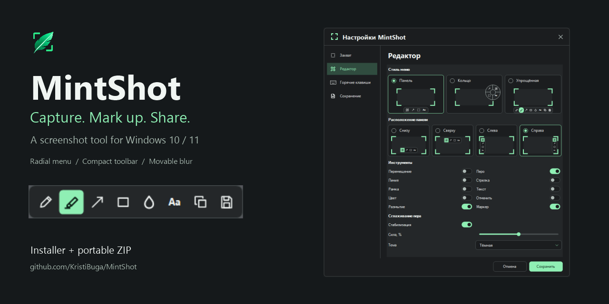
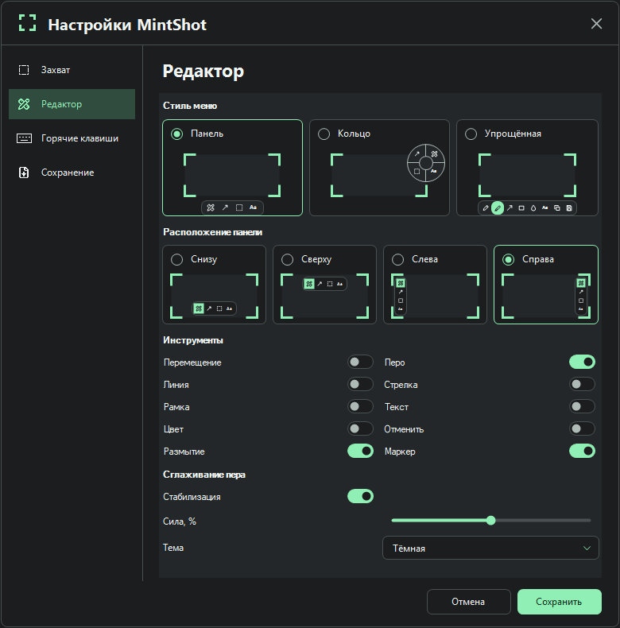
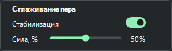

# MintShot

A screenshot and annotation app for **Windows 10 and Windows 11**.

**Select an area → add annotations → copy or save.** Choose a radial menu or a compact toolbar, highlight text, and move blur regions after drawing them.

**[Download installer](https://github.com/KristiBuga/MintShot/releases/download/v1.0.40/MintShotSetup-1.0.40.exe)** · **[Portable ZIP](https://github.com/KristiBuga/MintShot/releases/download/v1.0.40/MintShot-portable-1.0.40.zip)** · [All releases](https://github.com/KristiBuga/MintShot/releases) · [Русский](README.md)

## A closer look

Eight tools in one compact toolbar: pen, highlighter, arrow, rectangle, blur, text, copy, and save.


Choose a panel, radial menu, or simplified toolbar. Pick a toolbar edge and hide tools you do not use.



## Features

- Region capture and quick full-screen saving.
- Pen smoothing with adjustable stabilization strength.
- Translucent yellow highlighter, lines, arrows, rectangles, and text.
- Adjustable blur regions that can be repositioned.
- Customizable tools, light and dark themes, and a save folder setting.
- A capture context menu and native Windows notifications with MintShot branding.
- Update checking through GitHub Releases.

## Getting started

Run the installer, or extract the portable ZIP and start `MintShot.exe`. If MintShot is already running, exit it from the system tray before replacing its files.

Press **Print Screen** to start a capture. The capture shortcut can be changed in settings.

| Shortcut | Editor action |
| --- | --- |
| `Ctrl + C` | Copy screenshot |
| `Ctrl + S` | Save screenshot |
| `Ctrl + Z` | Undo |
| `Ctrl + X` | Redo |
| `Ctrl + A` | Select the whole screen |
| `Esc` | Close the radial menu or capture |

Right-click the pen icon to open smoothing settings. Select the blur tool to drag an existing blur region.



## Build

On Windows with .NET Framework 4.x, run from the repository root:

```powershell
powershell -ExecutionPolicy Bypass -File .\Build.ps1
```

The app is written to `Build\MintShot.exe`. To create an installer with Inno Setup 6:

```powershell
ISCC.exe /DReleaseBuild .\Installer\mintshot-inno.iss
```

The installer is written to `Releases\MintShotSetup-1.0.40.exe`.

`Source` contains the current UI, tools, capture, and updater code. The `.txt` files contain C# and are compiled by `Build.ps1`. `Core\MintShot.Core.exe` is a prebuilt editor core embedded in the application; its source is not included in the current working copy. `Resources` contains artwork and icon geometry, and `Installer` contains the setup script and artwork.

Icons use Lucide. Its license is included in `Resources\Geometry\LICENSE` and distributed with the app.

## Feedback

[Report a bug or suggest a feature](https://github.com/KristiBuga/MintShot/issues/new). Include your MintShot and Windows versions, steps to reproduce, and a screenshot or short recording when helpful.

If MintShot is useful to you, consider starring the repository or sharing it with someone who takes screenshots.
