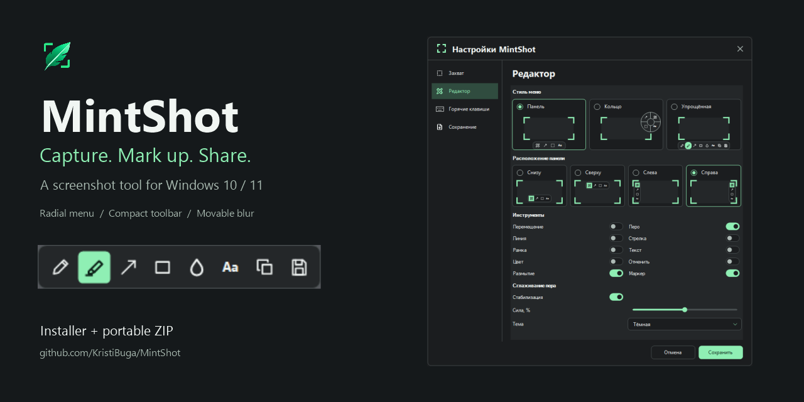
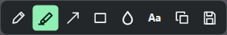
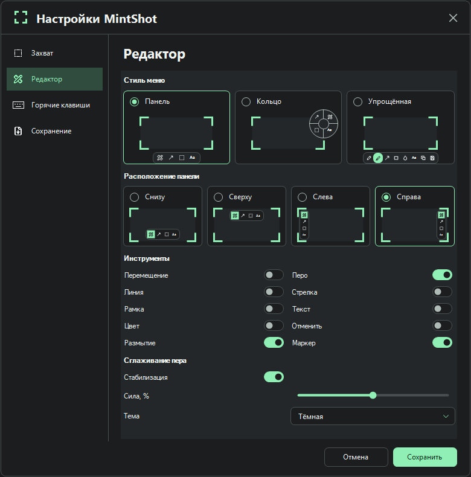
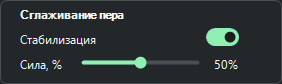

# MintShot

MintShot — приложение для скриншотов и разметки в Windows 10 и Windows 11.

**Выделите область → добавьте пометки → скопируйте или сохраните.** Кольцо инструментов, компактная панель, маркер и размытие, которое можно перемещать.

**[Скачать установщик](https://github.com/KristiBuga/MintShot/releases/download/v1.0.40/MintShotSetup-1.0.40.exe)** · **[Без установки](https://github.com/KristiBuga/MintShot/releases/download/v1.0.40/MintShot-portable-1.0.40.zip)** · [Все версии](https://github.com/KristiBuga/MintShot/releases) · [English](README.en.md)

## Как выглядит MintShot

Одна компактная панель: перо, маркер, стрелка, рамка, размытие, текст, копирование и сохранение.



Выберите привычную панель, круговое меню или упрощённый вариант. Укажите сторону размещения и скройте ненужные инструменты.



У пера есть стабилизация с регулировкой силы — её настройки открываются правым кликом по инструменту.



## Скачать

В [последнем релизе](https://github.com/KristiBuga/MintShot/releases/latest) доступны установщик Windows и ZIP без установки.

- Запустите `MintShotSetup-1.0.40.exe` для установки.
- Для запуска без установки распакуйте `MintShot-portable-1.0.40.zip` и откройте `MintShot.exe`.
- Если MintShot уже работает, завершите его через «Выход» в меню значка рядом с часами перед заменой файлов.

## Возможности

- Захват выделенной области и быстрое сохранение всего экрана.
- Перо со сглаживанием и регулировкой силы стабилизации.
- Полупрозрачный жёлтый маркер, линии, стрелки, рамки и текст.
- Размытие с регулировкой силы и перемещением нанесённого участка.
- Панель инструментов с выбором положения, упрощённая панель и круговое меню.
- Настройка видимых инструментов, светлая и тёмная темы, папка сохранения.
- Меню по правому клику внутри выделения.
- Системные уведомления Windows с логотипом MintShot.
- Проверка обновлений через GitHub Releases.

## Управление

Основная горячая клавиша по умолчанию — `Print Screen`. Её можно изменить в настройках.

| Клавиши | Действие в редакторе |
| --- | --- |
| `Ctrl + C` | Копировать снимок |
| `Ctrl + S` | Сохранить снимок |
| `Ctrl + Z` | Отменить правку |
| `Ctrl + X` | Вернуть отменённую правку |
| `Ctrl + A` | Выделить весь экран |
| `Esc` | Закрыть кольцо или захват |

Правый клик по иконке пера открывает настройку сглаживания. При выбранной капле нанесённое размытие можно перетянуть мышкой.

## Сборка

На Windows с .NET Framework 4.x запустите из корня репозитория:

```powershell
powershell -ExecutionPolicy Bypass -File .\Build.ps1
```

Результат появится в `Build\MintShot.exe`.

Для установщика требуется Inno Setup 6:

```powershell
ISCC.exe /DReleaseBuild .\Installer\mintshot-inno.iss
```

Установщик появится в `Releases\MintShotSetup-1.0.40.exe`.

## Состав проекта

- `Source` — текущий код интерфейса, инструментов, захвата и обновлений. Файлы с расширением `.txt` содержат C# и передаются компилятору из `Build.ps1`.
- `Core\MintShot.Core.exe` — готовое ядро редактора, которое встраивается в приложение. Его исходники отсутствуют в текущей рабочей копии.
- `Resources` — логотипы и геометрия иконок.
- `Installer` — сценарий и оформление установщика.

Иконки используют Lucide. Лицензия включена в `Resources\Geometry\LICENSE` и поставляется вместе с приложением.

## Обратная связь

Нашли ошибку? [Создайте issue](https://github.com/KristiBuga/MintShot/issues/new) и опишите, что нажали и что произошло. Укажите версию MintShot и Windows; снимок или короткая запись помогут воспроизвести проблему.

Идеи для новых функций тоже можно предложить через [Issues](https://github.com/KristiBuga/MintShot/issues). Если приложение пригодилось, поддержите проект звездой и поделитесь ссылкой.
